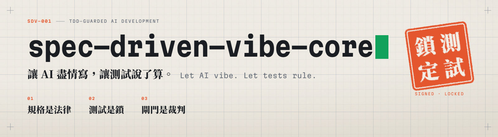
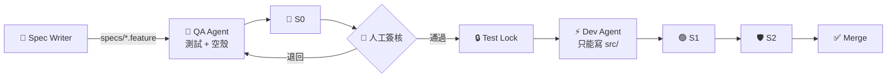

<picture>
  <source media="(prefers-color-scheme: dark)" srcset="assets/readme/hero-dark.png">
  
</picture>

<p align="center">
  
  
  
</p>

<p align="center">
  <b>以 TDD 驗證與約束 AI 所寫的程式碼</b><br>
  人類定義規格 → 測試被簽核鎖定 → AI 盡情 Vibe Coding → 三道閘門說了算
</p>

---

## 為什麼需要這個專案？

AI Agent 寫程式的速度快得驚人。但當測試失敗時，它有兩條路可以走：**修正程式碼，或是修改測試**——而後者往往更「省力」。

這不是 AI 的惡意，而是最佳化的本能，也就是 **Reward Hacking**。它會以各種形式出現：

- 🔓 直接修改測試的期望值
- 🎯 依測試輸入寫死回傳值
- 🙈 加上 `Skip`、`[ExcludeFromCodeCoverage]`、`#pragma warning disable`
- 🧩 在 Mock 的世界裡全部通過，在真實資料庫上全部失敗

本專案是一個**企業導入前的前置專案（Pilot）**：用最小的規模，把這套設計模式的「模式、規格、概念實作」做完整，讓架構師與工程師能親手驗證。

## 核心概念：3 × 3

| 三條鐵律 | 三層防線 | 三道閘門 |
|---|---|---|
| **規格是法律**<br/>只有人類能修改 `specs/` | **① Agent 層**<br/>權限 Deny ＋ PreToolUse Hook | **🔴 S0 Red**<br/>實作前測試 100% 失敗，且失敗原因皆為 `NotImplementedException` |
| **測試是鎖**<br/>簽核後以 SHA-256 鎖定，Dev Agent 唯讀 | **② 提交層**<br/>Git pre-commit | **🟢 S1 Green**<br/>測試 100% 通過；L1 覆蓋率 Line ≥ 95%／Branch ≥ 90% |
| **閘門是裁判**<br/>AI 說「完成了」不算 | **③ CI 層**<br/>Test Lock ＋ CODEOWNERS——**唯一權威** | **🛡️ S2 Guard**<br/>Lock 相符、反作弊掃描 0、突變分數 L1 ≥ 80% |

① ② 讓作弊在本機就失敗並留下紀錄，③ 才是保證。完整門檻：[`quality-gates.yml`](templates/quality-gates.yml)

## 運作方式



寫測試的 QA Agent 與寫實作的 Dev Agent 使用**不同的角色設定、Session 與模型**，避免兩邊犯同一個錯。

## v1 範圍

| 範圍內 | 留到正式導入 |
|---|---|
| **L1** 價格計算：PBT、突變測試 | L3 跨服務：Webhook 冪等、契約測試 |
| **L2** 庫存預留：SQLite、時間注入、MVC 整合測試 | L4 併發與非確定性 |
| ASP.NET Core MVC（.NET 9）單一專案 | Holdout 測試庫、容器隔離、E2E、SAST |

**刻意做小**：企業導入的第一步不該是大工程，而是用最小的成本證明概念成立。clone 下來不需要 Docker，`dotnet test` 就能跑。

## 快速開始：安裝護欄

護欄套件可以獨立用在任何專案：

```bash
cp -r templates/.claude templates/.githooks templates/.github templates/scripts templates/semgrep .
cp templates/quality-gates.yml templates/.gitattributes .
git config core.hooksPath .githooks

# 以 Dev 角色啟動 Claude Code，試著叫它修改測試
claude --settings .claude/roles/dev.settings.json
```

詳細步驟與紅隊驗證：[templates/README.md](templates/README.md)

## 依角色閱讀

| 你是 | 建議先讀 |
|---|---|
| 架構師 | [01 · 技術可行性](docs/01-technical-feasibility.md) → [02 · 難易度分級與導入路徑](docs/02-difficulty-grading.md) |
| 工程師 | [05 · 三道閘門](docs/05-verification-pipeline.md) → [templates/](templates/) |
| 技術主管 | [06 · 最沒把握的三件事](docs/06-top3-uncertainties.md) → [03 · 風險](docs/03-risks-and-unknowns.md) |

<details>
<summary>完整文件索引</summary>

| 文件 | 內容 |
|---|---|
| [00 · 執行總綱](docs/00-execution-roadmap.md) | 4 週計畫、每一步的完成定義與素材 |
| [01 · 技術可行性](docs/01-technical-feasibility.md) | 雙代理隔離、三層防線、Spec-to-Test、PBT 與突變測試 |
| [02 · 難易度分級](docs/02-difficulty-grading.md) | L1–L4 策略與正式導入路徑 |
| [03 · 風險及未知數](docs/03-risks-and-unknowns.md) | 風險矩陣、重試斷路器、已知的未知數 |
| [04 · 前置資源](docs/04-prerequisite-resources.md) | 護欄檔案、環境、工具鏈、角色重定義 |
| [05 · 驗證流水線](docs/05-verification-pipeline.md) | 三道閘門的順序與量化驗收 |
| [06 · 最沒把握的三件事](docs/06-top3-uncertainties.md) | 這套方法在哪裡會失敗 |
| [07 · 視覺識別](docs/07-visual-identity.md) | 品牌、畫面規範、拍攝清單 |
| [08 · 內容策略](docs/08-content-playbook.md) | LinkedIn／Threads／GitHub 發佈計畫 |

</details>

## Roadmap

- [x] 規劃書、護欄範本、視覺識別
- [ ] **Phase 0** · 方案骨架 ＋ 三層防線紅隊測試
- [ ] **Phase 1** · L1 價格計算：完整跑通 Spec-to-Test
- [ ] **Phase 2** · L2 庫存預留：SQLite ＋ 時間注入 ＋ MVC 整合測試
- [ ] **Phase 3** · Pilot 報告 ＋ `v1.0.0`

## 誠實聲明

這套方法**無法**保證規格本身正確，也**無法**完全偵測語意層級的作弊。限制寫在 [docs/06](docs/06-top3-uncertainties.md)，Pilot 報告也會公開不利於本方法的數據。

---

<details>
<summary><b>English summary</b></summary>

**spec-driven-vibe-core** is a pilot for constraining AI-generated code with TDD, built on ASP.NET Core MVC (.NET 9).

- **Specs are law** — only humans edit `specs/` (Gherkin).
- **Tests are locked** — after human sign-off, tests are fingerprinted (SHA-256) and read-only for the Dev Agent.
- **Gates are the judge** — "done" means three automated gates are green: Red Gate (100% failing for the right reason), Green Gate (tests and coverage), Guard Gate (test lock, anti-reward-hacking scans, mutation score).

Three layers of defense (Claude Code permissions + PreToolUse hook, git pre-commit, CI) keep the agent from editing tests. Only CI is authoritative; the other layers make cheating fail early and leave an audit trail. v1 deliberately covers only L1 (pure logic) and L2 (database and time); the project also publishes its own top three unsolved problems.

</details>
