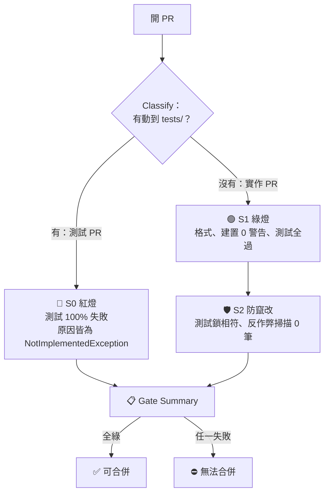

# spec-driven-vibe-core

**讓 AI agent 日常開發時照 TDD 走：先有規則，再有測試，最後才有實作，由 CI 說了算。**

.NET 9 · ASP.NET Core MVC · Claude Code · GitHub Actions

---

## 為什麼需要這個專案？

AI agent 寫程式很快，但測試失敗時它有兩條路：修實作，或改測試。後者更省力，這就是 **Reward Hacking**：改期望值、寫死回傳值、加 `Skip`、關掉警告。

本專案用最小的做法擋住這件事：測試經人簽核後鎖定，CI 負責把關。

## 四個步驟

| 步驟 | 做什麼 | 誰 | CI 把關 |
|---|---|---|---|
| 1 規則 | 規劃文件寫驗收規則，每條有 ID | 人 | — |
| 2 測試 | agent 依規則寫測試與 `NotImplemented` 骨架，人看過後鎖定 | agent + 人 | 🔴 紅燈 |
| 3 實作 | agent 只改實作，測試失敗不可改測試 | agent | 🟢 綠燈 |
| 4 完成 | 兩個燈都過才算完成 | CI | Gate Summary 全綠 |

## CI 怎麼判斷

測試與實作各開一個 PR。CI 先看這個 PR 有沒有動到 `tests/`：



- 測試 PR 沒有全紅：S0 失敗，不能合併。有測試一開始就綠，代表它沒驗到尚未實作的東西。
- 實作 PR 沒有全綠，或測試被改過：S1／S2 失敗，不能合併。
- `main` 要求 Gate Summary 必須綠，一律走 PR。
- 分支名稱以 `dev/` 開頭卻動了 `tests/`：Classify 直接失敗。

## 示範：價格計算

用「限量搶購價格計算」跑完整四步（規則 PRC-001 至 PRC-004）：

1. 規則：[`specs/flash-sale/price-calculation.feature`](specs/flash-sale/price-calculation.feature)
2. 測試：[`tests/FlashSale.Tests/Domain/PriceCalculatorTests.cs`](tests/FlashSale.Tests/Domain/PriceCalculatorTests.cs)，56 個案例，先 100% 紅燈，人簽核後產生 `tests.lock.json`
3. 實作：[`src/FlashSale.Web/Domain/PriceCalculator.cs`](src/FlashSale.Web/Domain/PriceCalculator.cs)，只改 `src/`，56 個測試全過
4. CI：測試 PR（#9）S0 通過，實作 PR（#11）S1、S2 通過

本機指令：

```bash
dotnet format --verify-no-changes
dotnet build -warnaserror
dotnet test
node scripts/test-lock.mjs verify
```

## 導入到你的專案

見 [11 · 導入指南](docs/11-adoption-guide.md)：最輕量的做法只需要規則表、提示詞樣板、測試鎖與 CI。連 agent 都擋住的 hook 與角色設定是選用。

## 誠實聲明：目前的限制

- **不適合規則天天在變的探索期功能。** 規則一改，就要重寫測試、人重新簽核、重新鎖定，會拖慢迭代。適合規則已定、錯了代價高的模組（金額、庫存、權限）；探索中的功能先不鎖，定型後再補。見[導入指南](docs/11-adoption-guide.md)。
- **規格本身對不對，這套方法管不到。** 規則寫錯，測試和實作會一起錯。
- **語意層級的作弊抓不到。** 例如測試寫得太弱，永遠通過。
- **CI 一開始沒有檢查「全紅」。** S0 原本只掃描與建置，不跑測試，PR #9 在沒驗紅燈的情況下全綠；後來補上 `scripts/ci/assert-red.mjs` 才真的把關。
- **同一個 PR 同時改 `tests/` 和 `src/`，目前不會被擋。** 它會被判為測試 PR，只跑 S0，不跑 `dotnet test`。
- **`quality-gates.yml` 的屬性測試門檻尚未被 CI 執行**，只是設定值。

## 進度

進度與驗收項目：[10 · 里程碑驗收總表](docs/10-milestone-checklist.md)。完整護欄版（四角色拆分、獨立審稿、突變測試）保存於標記 `v0.1-full`。
