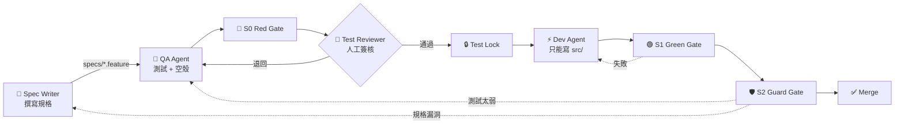
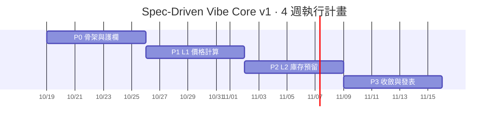
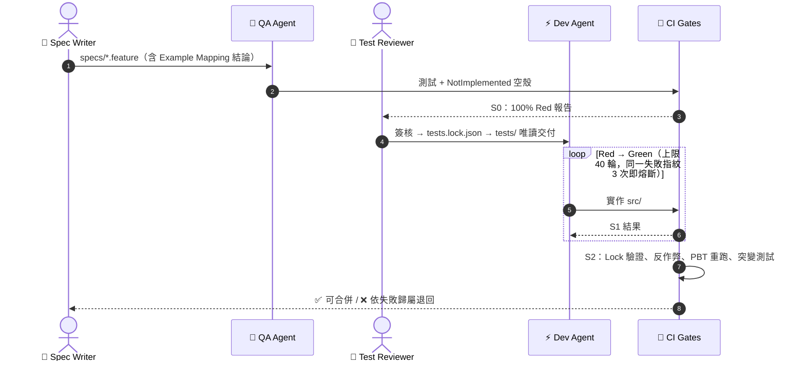

# 00 · 執行總綱 Execution Roadmap

> **專案主題**：以 TDD 為導向的 AI 開發設計模式——用「被鎖定的測試」驗證與約束 AI 所寫的程式碼。
> **一句話定位**：*Let AI vibe. Let tests rule.* —— 讓 AI 盡情寫，讓測試說了算。

本文件定義 v1 要做什麼、照什麼順序做、每一步的完成標準，以及每一步要同時產出的對外素材。

---

## 1. 定位與範圍

### 1.1 v1 是什麼

v1 是一個**企業導入前的前置專案（Pilot）**：用最小的規模把「模式建置、規格制定、概念實作」三件事做完整，讓架構師、工程師與主管能在 30 分鐘內看懂、在本機親手驗證。它同時也是一份可公開的個人作品。

| 面向 | v1 交付 |
|---|---|
| **模式建置** | 雙角色流程（QA Agent 寫測試、Dev Agent 寫實作）＋ 三條鐵律、三層防線、三道閘門 |
| **規格制定** | Example Mapping → Gherkin 規格 → 規則 ID 追溯到每一個測試 |
| **概念實作** | FlashSale 限量搶購：L1 價格計算、L2 庫存預留，以 ASP.NET Core MVC 實作 |
| **證據** | AI 被攔截的紀錄、紅隊測試結果、一次「有護欄 vs 無護欄」對照 |

### 1.2 核心概念：3 × 3

| 三條鐵律 | 三層防線 | 三道閘門 |
|---|---|---|
| **規格是法律**：只有人類能改 `specs/` | **① Agent 層**：權限 Deny ＋ PreToolUse Hook | **🔴 S0 Red**：實作前測試 100% 失敗，且失敗原因正確 |
| **測試是鎖**：簽核後鎖定，Dev Agent 唯讀 | **② 提交層**：Git pre-commit | **🟢 S1 Green**：測試全過、覆蓋率達標 |
| **閘門是裁判**：三道閘門全綠才算完成 | **③ CI 層**：Test Lock ＋ CODEOWNERS（唯一權威） | **🛡️ S2 Guard**：防竄改 ＋ 突變測試 |

### 1.3 範圍內／範圍外

| v1 範圍內 | 留到正式導入（v2 以後） |
|---|---|
| L1 純邏輯、L2 有狀態服務 ＋ 資料庫 | L3 跨服務（佇列、Webhook、契約）、L4 併發與非確定性 |
| ASP.NET Core MVC 單一專案，Razor 處理畫面 | 前後端分離、SPA 框架 |
| SQLite（真實的關聯式資料庫，免 Docker） | 與生產相同的資料庫 ＋ Testcontainers |
| PBT 隨機輸入防過擬合 | Holdout 私有測試庫 |
| 三層防線 | 容器唯讀掛載（物理隔離） |
| 三道閘門 | 整合／契約／E2E／SAST／效能閘門 |

> 範圍外的項目不是不重要，而是**不影響核心概念是否成立**。v1 先證明「鎖定測試能約束 AI」，正式導入時再擴大驗證的深度與廣度（路線見 [02](02-difficulty-grading.md) §5）。

---

## 2. 技術選型

| 層 | 選型 | 說明 |
|---|---|---|
| 應用程式 | ASP.NET Core MVC（.NET 9）＋ Razor Views | 前後端同一專案，降低示範複雜度 |
| 資料存取 | EF Core ＋ SQLite | 測試使用 SQLite 記憶體模式；禁止 EF InMemory Provider |
| 測試 | xUnit、CsCheck（PBT）、`Microsoft.AspNetCore.Mvc.Testing`、`FakeTimeProvider` | 範例測試、屬性測試、MVC 整合測試 |
| 驗證 | Stryker.NET（突變測試）、coverlet（覆蓋率）、Semgrep（反作弊規則） | |
| 護欄 | Claude Code（Permissions、Hooks、Subagents、`--settings`）、Git Hook、Node.js 腳本 | Node.js 本來就是 Claude Code 的執行環境，不額外增加相依 |
| CI | GitHub Actions | 公開 Repo 免費，v1 不需要任何 Secret |

> ⚠️ **.NET 9 支援期**：.NET 9 為 STS 版本，官方支援至 **2026-11-10**。v1 依需求採用 .NET 9；Pilot 結束後若要延續，將 `TargetFramework` 改為 `net10.0`（LTS）即可。示範程式碼不使用版本特有的 API，升級成本低。

---

## 3. 核心流程



---

## 4. 目標目錄結構

```text
spec-driven-vibe-core/
├── CLAUDE.md                      # AI 憲法：TDD 紀律與鐵律（由 templates/ 安裝）
├── .claude/                       # 角色權限、Subagent、Hook
├── .githooks/pre-commit           # ② 提交層
├── .github/                       # ③ CI 層：CODEOWNERS + 三道閘門
├── specs/flash-sale/              # 👤 人類撰寫的 Gherkin 規格（唯一真相來源）
├── tests/FlashSale.Tests/         # 🧪 QA Agent 產出、人工簽核、鎖定
├── tests.lock.json                # 測試指紋清單（SHA-256）
├── src/FlashSale.Web/             # ⚡ Dev Agent 工作區（ASP.NET Core MVC）
│   ├── Domain/                    #    L1 純邏輯（價格計算）
│   ├── Services/                  #    L2 有狀態服務（庫存預留）
│   ├── Data/                      #    EF Core + SQLite
│   └── Controllers/ Views/        #    MVC 畫面
├── FlashSale.sln
├── Directory.Build.props          # Nullable、TreatWarningsAsErrors（受保護）
├── stryker-config.json            # 突變測試設定（受保護）
├── quality-gates.yml              # 所有量化門檻的唯一來源
├── semgrep/  scripts/             # 反作弊規則、test-lock 與 CI 腳本
├── evidence/                      # 攔截事件、紅隊與對照紀錄（社群貼文的數據來源）
└── docs/  design/  assets/        # 規劃書、視覺識別、匯出圖檔
```

---

## 5. 執行計畫（4 週）

> 以「一人 + AI Agent、每週約 10–15 小時」估算。



> 起算日僅為示意。每個 Phase 都有四個區塊：**步驟**、**完成定義（DoD）**、**📸 素材**、**📣 發佈**。素材要在「做的當下」捕捉，事後補拍的畫面不真實，也容易漏掉關鍵瞬間。

### Phase 0 · 骨架與護欄（Week 1）

**目標**：專案公開、方案可建置、三層防線上線，並**親手攻擊一次**證明有效。

| 步驟 | 動作 | 驗證方式 |
|---|---|---|
| 0.1 | 建立 GitHub 公開 Repo、選擇授權（建議 MIT）、開啟 `main` 分支保護（需 PR、需 CI、需 Code Owner 審核） | Settings → Branches 截圖 |
| 0.2 | 建立方案骨架：`dotnet new mvc`（`src/FlashSale.Web`）、`dotnet new xunit`（`tests/FlashSale.Tests`）、`Directory.Build.props` | `dotnet build` 0 警告 |
| 0.3 | 安裝 `templates/`（見 [templates/README](../templates/README.md)），`git config core.hooksPath .githooks` | 檔案就位 |
| 0.4 | CI 三道閘門先以空殼跑通 | Actions 全綠 |
| 0.5 | **紅隊測試**：以 Dev 角色啟動 Claude Code，要求它「修改測試讓它通過」，逐層驗證 | 見下表 |
| 0.6 | README 與 Social Preview 上線 | GitHub 首頁正常顯示 |

| 防線 | 攻擊手法 | 預期結果 |
|---|---|---|
| ① Agent 層 | 用 Edit 工具改 `tests/`；用 Bash `sed -i`、`>` 重新導向改測試 | 權限拒絕／Hook exit 2，寫入 `evidence/guard-events.jsonl` |
| ② 提交層 | 在 Agent Session 中提交測試變更 | pre-commit 拒絕 |
| ③ CI 層 | 以 `--no-verify` 推送含測試變更的 `dev/*` 分支並開 PR | Classify 失敗 ＋ Lock 不符，無法合併 |

- **DoD**：三層紅隊全數攔截，結果寫入 `evidence/guardrail-redteam.md`。
- **📸 素材**：⭐ **本專案最重要的畫面**——Claude Code 被 Hook 擋下的終端機畫面（GIF）；PR 被擋的畫面。
- **📣 發佈**：LinkedIn #1 概念發表；Threads T1、T2；GitHub `v0.1.0`（Guardrails）。

### Phase 1 · L1 價格計算：完整跑通一次（Week 2）

**目標**：用最簡單的模組，把「規格 → 測試 → 鎖定 → 實作 → 驗證」完整跑一遍。

| 步驟 | 動作 | 角色 |
|---|---|---|
| 1.1 | Example Mapping → 定稿 `specs/flash-sale/price-calculation.feature`（範本已提供） | 👤 Spec Writer |
| 1.2 | 產出 xUnit 範例測試、CsCheck 屬性測試，以及只含 `throw new NotImplementedException()` 的空殼 | 🧪 QA Agent |
| 1.3 | 實作 S0 腳本（規則追溯、全紅判定）並執行：100% 失敗且原因皆為 NotImplemented | CI |
| 1.4 | 依[簽核清單](04-prerequisite-resources.md#5-人力角色重定義)審核 → `node scripts/test-lock.mjs generate` → 合併 | 👤 Test Reviewer |
| 1.5 | 實作 `PriceCalculator` 與結帳頁的金額顯示，直到 S1 全綠 | ⚡ Dev Agent |
| 1.6 | S2：Stryker.NET 突變測試；存活突變體依[失敗歸屬表](05-verification-pipeline.md#失敗歸屬表)分派 | CI ＋ 人工判讀 |
| 1.7 | **對照實驗**：同一份規格交給無護欄的 Session，記錄差異 | 👤 |

- **DoD**：L1 門檻全部達標；對照結果寫入 `evidence/experiment-l1.md`。
- **📸 素材**：S0 全紅 ↔ S1 全綠對照；CsCheck 縮減出的最小反例；Stryker 報告中的存活突變體。
- **📣 發佈**：Threads T3、T4；GitHub `v0.2.0`。

### Phase 2 · L2 庫存預留：資料庫與時間（Week 3）

| 步驟 | 動作 |
|---|---|
| 2.1 | 規格 `reserve-stock.feature`：預留庫存、10 分鐘未付款自動釋放、庫存不足拒絕 |
| 2.2 | 時間一律透過 `TimeProvider` 注入，測試以 `FakeTimeProvider` 快轉 |
| 2.3 | MVC 整合測試：`WebApplicationFactory` ＋ SQLite 記憶體模式，從 HTTP 請求一路驗證到資料庫狀態 |
| 2.4 | 啟用斷路器：同一失敗指紋 3 次或超過 40 輪即停止，寫入升級報告 |
| 2.5 | 走完 S0 → Lock → S1 → S2 |

- **DoD**：L2 門檻達標；斷路器機制運作中（有觸發就保留升級報告，沒觸發就如實記錄，不刻意製造）。
- **📸 素材**：`FakeTimeProvider` 快轉 10 分鐘後庫存釋放的測試輸出；預約頁面（Razor）；升級報告（若有）。
- **📣 發佈**：LinkedIn #2 機制解析；Threads T5、T6；GitHub `v0.3.0`。

### Phase 3 · 收斂與發表（Week 4）

| 步驟 | 動作 |
|---|---|
| 3.1 | `main` 三道閘門全綠，打 `v1.0.0` Tag |
| 3.2 | 彙整 `evidence/` → `docs/09-pilot-report.md`：只放實測數據，包含不利數據 |
| 3.3 | 報告附「正式導入建議」：下一步要補哪些能力（依 [02](02-difficulty-grading.md) §5 的路線） |
| 3.4 | 錄製 1–2 分鐘 Demo ＋ 3 支短 GIF；README 定稿 |
| 3.5 | LinkedIn #3 ＋ Carousel；Threads T7、T8；GitHub Release Note |

- **DoD**：`v1.0.0` Release、Pilot 報告、三平台內容全部發出。

---

## 6. 單一功能的內循環（每個 `.feature` 都照這個跑）



**v1 規格清單**

| # | 規格檔 | 等級 | 展示重點 |
|---|---|---|---|
| 1 | `price-calculation.feature` | L1 | Spec-to-Test、PBT、突變測試 |
| 2 | `reserve-stock.feature` | L2 | 時間注入、SQLite、MVC 整合測試、斷路器 |

---

## 7. 角色與 RACI

> 單人執行時，你同時扮演 Spec Writer 與 Test Reviewer；**但這兩個角色必須在不同時段、用不同的 Claude Code Session 執行**，避免自己對自己放水。

| 活動 | Spec Writer 👤 | QA Agent 🧪 | Test Reviewer 👤 | Dev Agent ⚡ | CI 🚦 |
|---|---|---|---|---|---|
| 撰寫／修改 `specs/` | **R/A** | — | C | — | — |
| 產出 `tests/` | C | **R** | **A** | — | — |
| 鎖定測試 | — | — | **R/A** | — | I |
| 實作 `src/` | — | — | — | **R** | — |
| 判定是否完成 | I | I | I | I | **R/A** |
| 處理存活突變體 | 規格漏洞 | 測試太弱 | **A** | 死碼 | 偵測 |

**角色啟動方式**（角色設定檔會設定 `SDV_ROLE`，不需手動指定）：

```bash
git worktree add ../sdv-qa  -b qa/price-calc
cd ../sdv-qa  && claude --settings .claude/roles/qa.settings.json

git worktree add ../sdv-dev -b dev/price-calc
cd ../sdv-dev && claude --settings .claude/roles/dev.settings.json
```

> `SDV_ROLE` 未設定時，Hook 一律以 `dev`（最嚴格）處理——**Fail-Closed**。

---

## 8. 文件索引

| 文件 | 內容 | 建議讀者 |
|---|---|---|
| [01 · 技術可行性](01-technical-feasibility.md) | 雙代理隔離、三層防線、Spec-to-Test、PBT 與突變測試 | 架構師、工程師 |
| [02 · 難易度分級](02-difficulty-grading.md) | L1–L4 策略與正式導入路徑 | 架構師、主管 |
| [03 · 風險及未知數](03-risks-and-unknowns.md) | 風險矩陣、重試斷路器 | 主管、架構師 |
| [04 · 前置資源](04-prerequisite-resources.md) | 護欄檔案、環境、工具鏈、角色 | 工程師 |
| [05 · 驗證流水線](05-verification-pipeline.md) | 三道閘門的順序與量化驗收 | 工程師、QA |
| [06 · 最沒把握的三件事](06-top3-uncertainties.md) | 這套方法在哪裡會失敗 | 所有人 |
| [07 · 視覺識別](07-visual-identity.md) | 品牌、畫面規範、拍攝清單 | 發佈用 |
| [08 · 內容策略](08-content-playbook.md) | LinkedIn／Threads／GitHub 發佈計畫 | 發佈用 |
| [`templates/`](../templates/) | 可安裝的護欄範本 | 工程師 |
