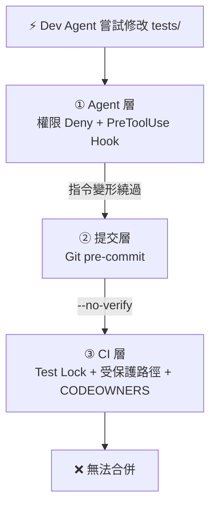
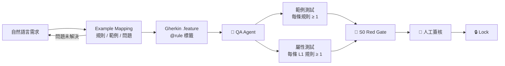

# 01 · 技術可行性評估 Technical Feasibility

> **結論先講**：「人類定義規格 → 鎖定測試 → AI 實作 → 自動化驗證」在現有工具鏈下**技術上可行**。檔案層級的隔離可以做得很扎實；**真正的難點在語意層級的作弊**：AI 沒有碰測試，卻寫出「剛好通過測試」的程式碼。v1 以 PBT 與突變測試處理這個問題，並標出殘餘風險。

## 1. 可行性總評

| 能力 | 可行度 | v1 作法 | 殘餘風險 |
|---|---|---|---|
| 禁止 Dev Agent 修改測試 | 🟢 高 | 三層防線，CI 為唯一權威 | Bash 指令攔截為字串比對，可能被繞過，由 CI 兜底 |
| 雙代理隔離 | 🟢 高 | 不同角色設定檔、Session、Worktree、模型 | 單人操作時，人類可能把 A 的 Context 貼給 B |
| 偵測 Hardcode／過度擬合 | 🟡 中 | PBT 隨機輸入、突變測試、Semgrep 規則 | 無法 100% 偵測，詳見 [06](06-top3-uncertainties.md) |
| 自然語言 → Gherkin → 測試 | 🟡 中 | Example Mapping ＋ 規則 ID 追溯 | 需求本身的漏洞無法被測試發現 |
| PBT ＋ 突變測試捕捉邏輯錯誤 | 🟢 高 | 套用於 L1、L2 | 突變測試成本隨程式碼規模上升 |

---

## 2. 雙代理隔離 Dual-Agent Isolation

### 2.0 概念：把團隊的「互相制衡」模擬出來

真實團隊不是靠某個人特別可靠，而是靠**分工讓人無法自己出題、自己作答、自己打分數**。本專案做的事，就是把這套分工用權限與流程強制重現，因為 AI 沒有人類之間的職責默契與信任。

| 真實團隊 | 本專案 | 負責 | 刻意不能做 |
|---|---|---|---|
| PO／SA | 📝 Spec Agent | 把需求起草成規格 | 不寫測試、不寫實作 |
| 資深工程師（審稿） | 🔎 Reviewer Agent | 挑規格的歧義與缺口 | 唯讀，不改規格 |
| QA 工程師 | 🧪 QA Agent | 依規格寫測試與空殼 | 不寫實作、不改規格 |
| 開發工程師 | ⚡ Dev Agent | 讓測試通過 | 不碰測試、不碰規格 |
| CI／Code Review | 🚦 三道閘門 | 決定能不能合併 | 不受前四者影響 |
| 主管／簽核者 | 👤 Approver（人） | 核准規格、核准合併 | 不親自寫規格、測試、實作 |

**對照現實的失敗模式**：一個人同時寫測試和實作，就會寫出「剛好通過」的測試；Dev 能改 QA 的測試，就等於考生自己改考卷。Reward Hacking 在人類團隊裡同樣存在，只是被分工與 Code Review 擋住了。

**現實中一個人常常身兼三職，所以人的角色改為只做兩次核准**：規格定稿時（合併 `spec/*` 分支的 PR）與最終合併時。其餘由 Agent 依角色接力，每個角色各自用 `claude --settings .claude/roles/<role>.settings.json` 啟動，手動一個接一個切換，不另寫自動編排。

**這是模擬，不是等價**：Approver 若不認真看規格，Spec Agent 與 Reviewer Agent 可能一起放過同一個錯（兩者雖用不同模型，仍可能犯相同的語意錯誤）。人類核准是整套設計唯一不由 AI 產生的信任根，不可省略。這項限制見 [06](06-top3-uncertainties.md)。

### 2.1 隔離的四個維度

只做「檔案權限」是不夠的。真正的隔離要同時切開四件事：

| 維度 | QA Agent 🧪 | Dev Agent ⚡ | 實作手段 |
|---|---|---|---|
| **寫入權限** | `tests/` | `src/` | 三層防線 |
| **可見範圍** | `specs/`、`src/` 介面簽章 | `specs/`、`tests/`（唯讀） | 角色設定檔 |
| **執行環境** | QA Worktree | Dev Worktree | `git worktree` ＋ 獨立 Session |
| **模型來源** | `opus` | `sonnet` | Subagent 的 `model:` 欄位 |

> **為什麼要換模型？** 同一個模型寫測試又寫實作，兩邊的誤解往往一致（Correlated Errors），測試會「剛好」漏掉實作會犯的錯。讓 QA Agent 與 Dev Agent 使用不同模型，是成本最低的多樣性來源。

### 2.2 權限矩陣

| 路徑 | Spec Writer 👤 | QA Agent 🧪 | Dev Agent ⚡ | CI 🚦 |
|---|---|---|---|---|
| `specs/**` | 讀寫 | 唯讀 | 唯讀 | 唯讀 |
| `tests/**`、`tests.lock.json` | 審核 | 讀寫 | **唯讀** | 驗證 |
| `src/**` | — | 僅限 NotImplemented 骨架¹ | 讀寫 | 唯讀 |
| 驗證設定（`stryker-config.json`、`*.runsettings`、`Directory.Build.props`、`quality-gates.yml`、`semgrep/`） | 審核 | 唯讀 | **唯讀** | 唯讀 |
| 治理檔（`.claude/`、`.github/`、`.githooks/`、`CLAUDE.md`） | 讀寫 | 唯讀 | **唯讀** | 唯讀 |

¹ QA Agent 需要建立介面與空殼類別，測試才能編譯。這不靠檔案權限限制，而是由 **S0 Red Gate** 強制：只要 QA 偷偷寫了任何真實邏輯，就會有測試通過，「100% 失敗」的條件立刻破功。

> **關鍵洞察：要鎖的不只是測試，而是整個「驗證面（Verification Surface）」。** AI 不改測試，也能改覆蓋率排除設定、降低突變門檻、在 CI 加上 `continue-on-error`。所有能影響「判定結果」的檔案都必須鎖定。

### 2.3 三層防線 Defense in Depth



| 防線 | 機制 | 擋得住 | 擋不住 | 定位 |
|---|---|---|---|---|
| ① Agent 層 | `permissions.deny` ＋ [`guard-tests.mjs`](../templates/.claude/hooks/guard-tests.mjs)（exit 2） | Edit／Write 工具；常見 Bash 寫檔（`sed -i`、重新導向、`git checkout --`）；並**記錄每次嘗試** | 刻意混淆的指令（如 base64 解碼後執行） | 攔截 ＋ 可觀測性 |
| ② 提交層 | `.githooks/pre-commit` | Agent 身分的本機提交 | `--no-verify`（① 會攔此參數） | 本機最後防線 |
| ③ CI 層 | Lock 驗證、受保護路徑檢查、CODEOWNERS、分支保護 | **一切**——唯一不可繞過的一層 | — | 權威裁判 |

**設計原則**：① ② 讓作弊在本機就失敗、並留下紀錄；③ 才是保證。三層共用同一份規則（`guard-tests.mjs`），不會出現規則不同步。

> **正式導入時可加的第四層**：讓 Dev Agent 在容器中執行，`tests/` 以 `:ro` 唯讀掛載。注意**不可**把主機的 `docker.sock` 掛進容器——擁有 Docker Socket 等同擁有主機權限，唯讀掛載會形同虛設。

### 2.4 Dev Agent 該不該看得到測試？

| 方案 | 優點 | 缺點 | v1 |
|---|---|---|---|
| **公開唯讀** | 修正最快 | 可能針對測試「量身訂做」 | ✅ 採用，以 PBT ＋ 突變測試抵銷 |
| 全隱藏 | 最難作弊 | 修正迴圈變長、Token 暴增 | — |
| 公開 ＋ Holdout | 兼顧速度與防過擬合 | 需維護一個 Agent 看不到的私有測試庫 | 正式導入時加入 |

> **PBT 是 v1 防過擬合的主力**：屬性測試每次執行都產生新的隨機輸入，對 Dev Agent 而言，等於一組**每次都不一樣、無法事先背答案**的測試。

### 2.5 反 Hardcode 技術組合

| AI 作弊手法 | 偵測技術 | 原理 |
|---|---|---|
| `if (qty == 3) return 270m;` | **PBT** | 每次 1,000 組隨機輸入，寫死的值無法通過 |
| 寫了用不到的分支／死碼 | **突變測試** | 突變後測試仍通過 → 這段程式碼沒被驗證 |
| `[ExcludeFromCodeCoverage]`、`Skip =`、空 `catch`、偵測 CI 環境 | **Semgrep 反作弊規則** | 靜態掃描，0 容忍 |
| 修改測試、測試設定或 CI | **Test Lock ＋ CODEOWNERS** | 驗證面整體鎖定 |
| 吞掉例外讓測試不爆 | **反例測試 ＋ 突變測試** | 規格要求的錯誤碼必須被斷言 |

---

## 3. 規格轉測試管線 Spec-to-Test Pipeline



**Example Mapping 是整條管線的第一個品質閘門**：每條規則都要有具體範例，整份規格要涵蓋正向、邊界、反例三類；所有「問題卡」都必須解決，才進入 Gherkin。這一步不交給 AI 單獨完成——它是人類對需求負責的地方。

### 3.1 從規格到測試：同一條規則的兩種樣貌

規格（節錄自 [`price-calculation.feature`](../templates/specs/flash-sale/price-calculation.feature)）：

```gherkin
@rule:PRC-001
Rule: 總額等於小計減去折扣，折扣向下捨去至分

  @boundary
  場景大綱: 捨入與極值邊界
    ...
    例子:
      | 單價   | 數量 | 折扣率 | 總額 |
      | 0.01   | 1    | 0.50   | 0.01 |
      | 999.99 | 99   | 1.00   | 0.00 |
```

QA Agent 產出的測試（以 `Trait` 追溯回規則）：

```csharp
// decimal 不能直接作為 Attribute 參數，因此以字串傳入
[Theory, Trait("Rule", "PRC-001"), Trait("Kind", "boundary")]
[InlineData("0.01", 1, "0.50", "0.01")]   // 0.01 元打五折：折扣 0.005 向下捨去為 0，總額仍為 0.01
[InlineData("999.99", 99, "1.00", "0.00")]
public void Total_follows_the_round_down_rule(string price, int qty, string rate, string total)
{
    var result = PriceCalculator.Calculate(Money(price), qty, Money(rate));
    Assert.Equal(Money(total), result.Total);
}

static decimal Money(string s) => decimal.Parse(s, CultureInfo.InvariantCulture);
```

> 「0.01 元打五折，總額仍為 0.01」隱含了「折扣向下捨去至分」這個**商業決策**。這類邊界正是 AI 最常出錯、也最常被人類忽略的地方；捨入規則必須在 Example Mapping 階段定案並寫進規格。

**可追溯性**：每個規則帶 `@rule:XXX-NNN` 標籤，每個測試帶相同的 `Trait("Rule", ...)`；S0 腳本比對兩者，**規則追溯率必須 100%**。

---

## 4. 深度驗證技術

### 4.1 AI 常見錯誤 × 偵測技術

| AI 常見錯誤 | 範例測試 | PBT | 突變測試 |
|---|---|---|---|
| Off-by-one（`<` vs `<=`） | 視案例 | ✅ | ✅ |
| 捨入／精度錯誤（用 `double` 算錢） | 視案例 | ✅ | — |
| 極大值、溢位 | 常漏 | ✅ | — |
| 無效／冗餘程式碼 | ❌ | ❌ | ✅ |
| 條件反轉但測試沒覆蓋 | ❌ | 部分 | ✅ |

### 4.2 屬性基礎測試 Property-Based Testing

PBT 不寫「輸入 3 得到 270」，而是寫「對**所有**合法輸入都必須成立的性質」，由框架自動產生大量輸入，並在失敗時**自動縮減（Shrinking）到最小反例**。

| 性質 | 描述 |
|---|---|
| 非負性 | `Total >= 0` |
| 有界性 | `Discount <= Subtotal` |
| 單調性 | 增加數量，小計不會變少 |
| 精度 | 總額永遠精確到分（小數位數 ≤ 2） |

```csharp
// tests/FlashSale.Tests/Properties/PriceCalculatorProperties.cs
static readonly Gen<decimal> Price = Gen.Int[1, 10_000_000].Select(c => c / 100m); // 0.01–100,000.00
static readonly Gen<decimal> Rate  = Gen.Int[0, 100].Select(p => p / 100m);        // 0.00–1.00

[Fact, Trait("Rule", "PRC-001"), Trait("Kind", "property")]
public void Total_is_never_negative_and_discount_never_exceeds_subtotal() =>
    Gen.Select(Price, Gen.Int[1, 99], Rate)
       .Sample((price, qty, rate) =>
       {
           var r = PriceCalculator.Calculate(price, qty, rate);
           return r.Total >= 0m && r.Discount <= r.Subtotal;
       }, iter: 1_000);
```

> **重現性**：CsCheck 失敗時會輸出 Seed；以相同 Seed 重跑必須得到相同反例。

### 4.3 突變測試 Mutation Testing

突變測試回答的問題是：**「你的測試真的能抓到錯誤嗎？」** 工具會自動在實作中植入小錯誤（把 `>=` 改成 `>`、刪掉一行），若測試仍然全過，代表這個突變體「存活」——要嘛測試太弱，要嘛那段程式碼根本沒必要。

| 結果 | 意義 | 處置 |
|---|---|---|
| Killed | 測試抓到植入的錯誤 | ✅ |
| Survived | 測試沒抓到 | 依[失敗歸屬表](05-verification-pipeline.md#失敗歸屬表)分派 |
| No Coverage | 沒有任何測試執行到 | 通常是 AI 多寫的死碼 → Dev 移除 |

```json
// stryker-config.json（受保護的驗證面檔案；門檻由 CI 從 quality-gates.yml 帶入）
{
  "stryker-config": {
    "project": "FlashSale.Web.csproj",
    "test-projects": ["tests/FlashSale.Tests/FlashSale.Tests.csproj"],
    "reporters": ["html", "json", "progress"]
  }
}
```

> **成本控制**：v1 程式碼量小，每個 PR 都跑全量。規模擴大後改為「PR 只跑增量（`since`）＋ 夜間全量」。

---

## 5. 可行性結論與前提條件

**可行，但有三個前提**：

1. **驗證面必須整體鎖定**——只鎖 `tests/` 等於沒鎖。
2. **CI 必須是唯一的權威裁判**——本機防護只是讓失敗提早發生，並留下紀錄。
3. **人類不可退出迴圈**——Example Mapping 與測試簽核這兩個節點，是整套方法有效的根基；自動化的範圍是「實作」，不是「判斷」。

下一步：[02 · 難易度分級](02-difficulty-grading.md)
