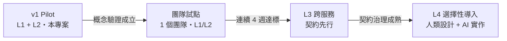

# 02 · 難易度分級 Difficulty Grading（L1–L4）

> **核心原則**：等級越高，**AI 自主度越低、人類介入越早、驗證手段越貼近真實環境**。
> **v1 只實作 L1 與 L2**——足以證明核心概念；L3、L4 先定義策略，作為正式導入時的擴充路線。

## 1. 分級總覽

| 等級 | 範圍 | 示範情境（FlashSale） | AI 自主度 | 人類介入點 | 核心驗證技術 | 門檻（Line / Branch / Mutation） | v1 |
|---|---|---|---|---|---|---|---|
| **L1** | 純函式、DTO 驗證 | 價格計算 | 🟢 高 | 規格 ＋ 測試簽核 | 範例測試、PBT、突變測試 | 95 / 90 / ≥ 80 | ✅ 實作 |
| **L2** | 有狀態邏輯、資料庫、時間 | 庫存預留與逾時釋放 | 🟢 中高 | ＋ 資料存取程式碼抽審 | SQLite 整合測試、時間注入、MVC 整合測試 | 90 / 80 / ≥ 70 | ✅ 實作 |
| **L3** | 佇列、外部 API、跨服務 | 金流 Webhook 冪等 | 🟡 中 | ＋ 契約審核、程式碼全審 | 契約測試、故障注入 | 85 / 75 / ≥ 60 | 📄 策略 |
| **L4** | 併發、非確定性 | 併發搶購不超賣 | 🔴 低 | ＋ **規格前**的設計審查 | 重複壓力測試、蛻變／差分測試 | 80 / 70 / 僅觀測 | 📄 策略 |

> v1 的門檻唯一來源是 [`quality-gates.yml`](../templates/quality-gates.yml)（只定義 L1、L2）。L3、L4 的數值是建議值，正式導入時再寫入。

---

## 2. L1 · 純粹邏輯層

**定義**：無副作用、無 I/O、相同輸入永遠得到相同輸出。

| 項目 | 內容 |
|---|---|
| 示範模組 | `Domain/PriceCalculator`（折扣、捨入、輸入範圍驗證），結帳頁顯示其計算結果 |
| 實作重點 | 金額一律 `decimal`；捨入規則寫進規格；錯誤以錯誤碼回傳，而非例外訊息字串 |
| 測試策略 | 每個場景都有對應測試；每條規則 ≥ 1 個屬性測試（≥ 1,000 次迭代） |
| AI 自主度 | 高：測試簽核後，Dev Agent 可完全自主迭代至全綠 |
| AI 典型失誤 | 用 `double` 算錢、捨入時機錯誤、`<` 與 `<=` 混淆 |
| 為什麼是最佳起點 | 驗證成本最低、回饋最快，最適合讓團隊**親眼看到** PBT 與突變測試抓到 AI 的錯 |

---

## 3. L2 · 單一服務與資料存取層

**定義**：具備狀態的商業邏輯，涉及資料庫讀寫與時間。

| 項目 | 內容 |
|---|---|
| 示範模組 | `Services/ReservationService`：預留庫存 → 10 分鐘內未付款自動釋放；`ReservationsController` ＋ Razor 預約頁 |
| 實作重點 | EF Core ＋ SQLite；時間一律透過 `TimeProvider` 注入；以條件式更新避免庫存變成負數 |
| 測試策略 | **服務層**：SQLite 記憶體模式（每個測試一條獨立連線）＋ `FakeTimeProvider` 快轉時間 **MVC 層**：`WebApplicationFactory` 送出 HTTP 請求，同時驗證回應與資料庫狀態 |
| 禁止事項 | ❌ `UseInMemoryDatabase`　❌ Mock 自己的 Repository 來測自己的 Service |
| Mock 邊界 | 只 Mock「架構邊界之外」的東西：第三方 API、郵件、時間 |
| AI 典型失誤 | 用 `DateTime.Now` 讓測試無法控制、先查後改導致庫存為負、Migration 與 Model 不一致 |

> **為什麼用 SQLite，而不是 EF InMemory？** InMemory Provider 不是關聯式資料庫：不檢查外鍵與唯一約束、沒有真正的交易，測試會在一個「比真實世界寬鬆」的環境裡通過。SQLite 是真正的關聯式資料庫，測試本身不需要 Docker，任何人 clone 下來 `dotnet test` 就能跑；Docker 只用在「一鍵運行」Demo 與驗證，是為了方便審閱者，不是測試的相依。正式導入時，再換成與生產環境相同的資料庫（Testcontainers）。

> **為什麼禁止過度 Mock？** AI 很擅長寫出「Mock 回傳什麼就斷言什麼」的測試——這種測試永遠通過，卻什麼都沒驗證。

---

## 4. L3、L4 · 正式導入時的擴充策略（v1 不實作）

| 等級 | 情境 | 關鍵策略 | 驗收標準 |
|---|---|---|---|
| L3 | 金流 Webhook 重送、逾時、亂序 | 以事件 ID 做冪等鍵（資料庫唯一約束）；Outbox 與業務資料同一交易；契約測試；故障注入 | 同一事件重送 5 次只入帳 1 次 |
| L4-a | 1,000 個請求搶 100 件庫存 | **人類先決定併發策略**（條件式原子更新為主）；所有請求同時起跑、重複 50 輪 | 50 輪中超賣 0 次 |
| L4-b | 結帳 UI 與倒數計時 | 瀏覽器自動化 ＋ 時間控制；禁止固定等待 | Flaky rate ≤ 1% |
| L4-c | 沒有標準答案的演算法 | **蛻變測試**（平移、旋轉後結果不變）；**差分測試**（與可信的參考實作比對） | 10,000 組隨機輸入與參考實作一致 |

> L4 的 AI 自主度最低：**人類必須在寫規格之前先完成設計決策**，AI 只負責依既定設計實作。讓 AI 自己選併發策略，是這個等級最常見的災難來源。

---

## 5. 從 Pilot 到正式導入

| 階段 | 進入條件 | 需要新增的能力 | 回退條件 |
|---|---|---|---|
| Pilot → 團隊試點 | 三層紅隊全數攔截；L1／L2 門檻達標；Pilot 報告完成 | 團隊 CODEOWNERS、Holdout 測試庫、容器隔離 | — |
| 團隊試點 → L3 | 連續 4 週達標；團隊能獨立做 Example Mapping | Testcontainers、契約測試、故障注入 | 斷路器觸發率 > 20% |
| L3 → L4 | 契約變更流程順暢；有專人負責設計審查 | 壓力測試、E2E、夜間全量突變測試 | L4 驗證成本超過人工開發成本 |

下一步：[03 · 風險及未知數](03-risks-and-unknowns.md)
