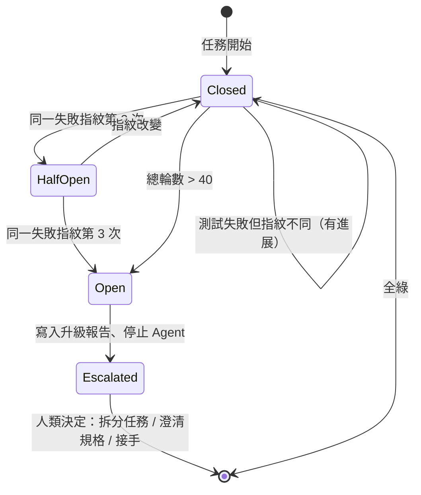

# 03 · 風險及未知數 Risks & Unknowns

> 本文件列出導入過程中**可預見**的風險（Known Risks）與**尚無答案**的未知數（Known Unknowns）。每項風險都附「早期警訊」——在它真正爆炸前，應該從哪個指標看到它。

## 1. 風險矩陣

| ID | 風險 | 可能性 | 衝擊 | 早期警訊 | 主要緩解 |
|---|---|---|---|---|---|
| R1 | 規格漏洞與測試盲區 | 高 | 高 | 「測試全綠但行為錯誤」的缺陷占比 > 20% | Example Mapping、QA Agent 先列缺口 |
| R2 | 測試維護成本爆炸 | 高 | 中 | 每次重構平均壞掉測試 > 10 個 | 只測行為、測試預算 |
| R3 | Token 消耗與重試死鎖 | 中 | 中 | 單任務 > 40 輪；同一失敗指紋 ≥ 3 次 | 重試斷路器 |
| R4 | 團隊抗拒與技能退化 | 中 | 高 | 「無法解釋 AI 程式碼」的 PR 增加；測試審核 < 2 分鐘 | Explain-back、Spec Kata |
| R5 | 驗證面遭繞過 | 中 | 高 | `guard-events.jsonl` 攔截數突增；設定檔出現非預期變更 | 驗證面整體鎖定、CI 為唯一權威 |
| R6 | 模型版本漂移 | 中 | 中 | 換版後重試輪數、攔截數明顯變動 | 固定模型版本、換版前重跑對照實驗 |
| R7 | 機敏資料進入 Context | 低 | 高 | Secret Scanning 命中 | 禁止讀取 `.env*`、`secrets/**` |

---

## 2. 核心風險

### R1 · 規格漏洞與測試盲區

**問題本質**：TDD 只能保證「程式碼符合測試」，測試只能保證「符合規格」。規格錯了，整條管線會**精準地、全綠地**交付錯誤的東西——而且因為一切看起來都通過了，信心反而更高。

| 時機 | 手段 | 做法 |
|---|---|---|
| 寫規格前 | Example Mapping | 每條規則都有具體範例；未解的問題卡不得進入 Gherkin |
| 寫規格時 | 審查清單 | 邊界值？捨入？時區？錯誤碼？空值？ |
| 寫測試前 | QA Agent 反向提問 | QA Agent 先列出規格未定義的情境，寫入 `evidence/spec-gaps/`，由人類決定 |
| 上線後 | 缺陷歸因 | 每個缺陷都要回答：規格漏了、測試漏了，還是實作錯了？ |

### R2 · 測試維護成本爆炸

**問題本質**：AI 產生測試的成本趨近於零，測試數量容易失控；且 AI 傾向測試**實作細節**，導致任何重構都引發大量失敗。

- **只測行為**：測試只能透過公開介面斷言可觀察的結果；不驗證私有方法與內部呼叫次數。
- **測試預算**：每條規則的範例測試以 8 個為上限，超過需說明理由；能用屬性測試表達的，不寫大量範例。

### R3 · Token 消耗與重試死鎖

**問題本質**：Dev Agent 可能反覆嘗試同一種錯誤的修法，每一輪都把失敗輸出塞進 Context，Context 越髒、判斷越差、成本越高。

**緩解：重試斷路器（Retry Circuit Breaker）**

| 機制 | 做法 |
|---|---|
| 失敗指紋 | 測試名稱 ＋ 例外型別 ＋ 正規化後的訊息 |
| v1 實作方式 | 寫在 `dev-agent.md` 與 `CLAUDE.md` 中由 Agent 自律；無人值守時以 `claude -p --max-turns 40` 設定硬上限 |
| 熔斷後 | **不在原 Session 續跑**，改以「嘗試摘要」開新 Session |
| 升級報告 | `evidence/escalations/<task>.md`：嘗試過的方法、失敗指紋、Agent 自評的卡點 |

> **熔斷不是失敗，是資訊。** 熔斷率過高（> 20%）通常代表規格粒度太大或規格本身矛盾，而不是模型不夠強。

### R4 · 團隊抗拒與技能退化

**問題本質**：資深工程師覺得「寫規格比寫程式還慢」而抗拒；資淺工程師過度依賴 AI，逐漸失去閱讀與除錯能力。後者更危險，因為短期內看起來是生產力提升。

| 對象 | 手段 |
|---|---|
| 全員 | **Explain-back**：PR 作者必須能解釋 AI 程式碼的關鍵決策，Reviewer 隨機抽問 |
| 資淺 | **Spec Kata**：同一需求由不同人寫 Example Mapping，比較彼此的盲點 |
| 資深 | 定位為 Spec Writer／Test Reviewer／Guardrail Engineer，把時間花在高槓桿處 |
| 管理層 | 不量測「AI 產生的行數」，改量測缺陷逃逸率、重工率、突變分數 |

---

## 3. 已知的未知數 Known Unknowns

這些問題**目前沒有可靠答案**。v1 的樣本很小，只能提供初步觀察，不會假裝已經解決。

| # | 未知數 | 為什麼重要 | v1 的觀測方式 |
|---|---|---|---|
| U1 | 多少比例的作弊是「無意的」？ | AI 寫死回傳值，往往是誤解規格而非刻意投機；處置方式不同 | 每筆攔截事件人工標註「刻意／誤解」 |
| U2 | 雙模型能降低多少同源盲點？ | 決定 QA Agent 是否值得用較貴的模型 | 記錄突變測試存活數，作為正式導入時對照的基準 |
| U3 | 突變分數與實際缺陷率的相關性？ | 若相關性弱，80% 門檻只是儀式 | 需長期追蹤，v1 不下結論 |
| U4 | 整體 ROI 何時轉正？ | 決定企業是否擴大導入 | 記錄每個規格從撰寫到合併的總人時、Token 與 CI 分鐘 |

下一步：[04 · 前置資源清單](04-prerequisite-resources.md)
