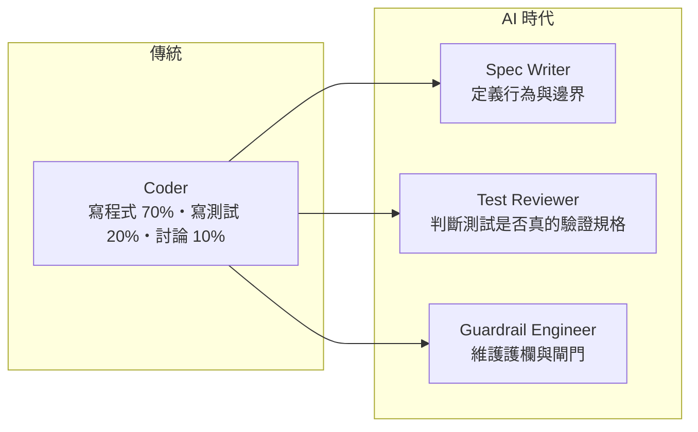

# 04 · 前置資源清單 Prerequisite Resources

> 本文件盤點啟動 v1 所需的一切：AI 護欄、開發環境、工具鏈、帳號與角色。所有設定檔範本都在 [`templates/`](../templates/)，Phase 0 時安裝到根目錄。

## 1. AI 規則與防護欄 Guardrails

### 1.1 檔案清單

| 檔案（安裝後路徑） | 範本 | 用途 | 防線 |
|---|---|---|---|
| `CLAUDE.md` | [`CLAUDE.project.md`](../templates/CLAUDE.project.md) | AI 憲法：TDD 紅綠燈紀律、鐵律、角色行為 | 行為約束 |
| `.claude/settings.json` | [連結](../templates/.claude/settings.json) | 共用 Hook、禁止讀取 `.env` 與 Secrets | ① |
| `.claude/roles/dev.settings.json` | [連結](../templates/.claude/roles/dev.settings.json) | Dev 角色：禁止寫入 `tests/`、`specs/`、驗證面 | ① |
| `.claude/roles/qa.settings.json` | [連結](../templates/.claude/roles/qa.settings.json) | QA 角色：禁止寫入 `specs/` 與治理檔；`src/` 僅限骨架（由 S0 強制） | ① |
| `.claude/agents/qa-agent.md` | [連結](../templates/.claude/agents/qa-agent.md) | QA Subagent：只產出測試，先列規格缺口 | Context |
| `.claude/agents/dev-agent.md` | [連結](../templates/.claude/agents/dev-agent.md) | Dev Subagent：只改 `src/`，遵守斷路器 | Context |
| `.claude/hooks/guard-tests.mjs` | [連結](../templates/.claude/hooks/guard-tests.mjs) | 受保護路徑攔截 ＋ `evidence/guard-events.jsonl` 紀錄 | ①②③ |
| `.githooks/pre-commit` | [連結](../templates/.githooks/pre-commit) | 本機提交攔截 | ② |
| `.github/CODEOWNERS` | [連結](../templates/.github/CODEOWNERS) | 受保護路徑必須人工審核 | ③ |
| `.github/workflows/verification-pipeline.yml` | [連結](../templates/.github/workflows/verification-pipeline.yml) | 三道閘門 | ③ |
| `scripts/test-lock.mjs` | [連結](../templates/scripts/test-lock.mjs) | 產生／驗證測試指紋 | ③ |
| `quality-gates.yml` | [連結](../templates/quality-gates.yml) | 所有量化門檻的唯一來源 | ③ |
| `semgrep/anti-reward-hacking.yml` | [連結](../templates/semgrep/anti-reward-hacking.yml) | 反作弊靜態規則 | ③ |

### 1.2 `CLAUDE.md` 必備章節

| 章節 | 必須包含 |
|---|---|
| 三條鐵律 | 規格是法律、測試是鎖、閘門是裁判 |
| TDD 紅綠燈紀律 | Red（只寫骨架）→ Green（最小實作）→ Refactor（測試保持全綠）；禁止跳步 |
| 角色 | 依 `SDV_ROLE` 區分 QA／Dev 的允許與禁止事項 |
| 合法的出口 | 規格缺口、測試異議、卡關時**停止並回報**，寫入 `evidence/`，絕不自行繞過 |
| 絕對禁止 | 寫死測試值、`Skip`、覆蓋率排除、空 `catch`、`DateTime.Now`、`--no-verify` |

> **給 AI 一個「合法的出口」**是整份憲法最重要的設計。如果 AI 認為測試有錯卻沒有正當管道表達，它就更可能選擇偷偷繞過。`evidence/test-disputes/` 就是這個出口。

---

## 2. 開發環境

### 2.1 本機

| 項目 | 需求 | 備註 |
|---|---|---|
| .NET SDK | 9.0 | 支援期至 2026-11-10，見 [00](00-execution-roadmap.md) §2 |
| Node.js | 22 LTS 以上 | Claude Code 與護欄腳本 |
| Claude Code | 最新版 | 需支援 Hooks、Subagents、`--settings` |
| Git | 2.40 以上 | `worktree`、`core.hooksPath` |
| Docker | **不需要** | v1 使用 SQLite；正式導入改用 Testcontainers 時才需要 |
| 硬體 | 一般開發筆電（建議 16 GB RAM） | 突變測試最吃資源，v1 規模下約數分鐘 |

### 2.2 CI

| 項目 | 規格 |
|---|---|
| Runner | GitHub-hosted `ubuntu-latest`（內建 `pipx`、`yq`） |
| 快取 | NuGet 套件 |
| 時間預算 | PR 全流程 ≤ 10 分鐘 |
| 機密 | 無——v1 不需要任何 Secret |

---

## 3. 工具鏈

| 類別 | 工具 | 閘門 |
|---|---|---|
| 建置 | `Directory.Build.props`：`Nullable`、`TreatWarningsAsErrors` | S0、S1 |
| 格式 | `dotnet format --verify-no-changes` | S1 |
| 範例／屬性測試 | xUnit ＋ CsCheck | S0、S1 |
| 整合測試 | `WebApplicationFactory` ＋ SQLite ＋ `FakeTimeProvider` | S1 |
| 覆蓋率 | coverlet | S1 |
| 突變測試 | Stryker.NET（`dotnet tool`） | S2 |
| 反作弊 | Semgrep 自訂規則 | S0、S2 |

---

## 4. 帳號與外部服務

| 服務 | 用途 | 成本 |
|---|---|---|
| GitHub（公開 Repo） | 程式碼、Actions、CODEOWNERS、分支保護、Social Preview | 免費 |
| Agent 專用 GitHub 帳號 | 單人專案時由它推送分支、開 PR，你以 Code Owner 身分審核 | 免費 |
| Claude Code | QA／Dev Agent | 依方案；記錄每個任務的 Token 用量 |

---

## 5. 人力角色重定義

| 角色 | 職責 | 核心技能 | 由誰轉型 |
|---|---|---|---|
| **Spec Writer** | 主持 Example Mapping、撰寫 Gherkin、回應 QA Agent 的缺口提問 | 領域知識、邊界思維 | 資深工程師、PO、SA |
| **Test Reviewer** | 簽核測試：是否測行為？邊界是否完整？有無過度 Mock？ | 測試設計、突變報告判讀 | 資深工程師、QA |
| **Guardrail Engineer** | 維護 Hook、角色設定、CI 閘門、反作弊規則；分析攔截事件 | CI/CD、Claude Code 進階設定 | DevOps、平台工程師 |
| **Agent Operator** | 日常驅動 Dev Agent、處理升級報告 | 閱讀程式碼、除錯 | 一般工程師 |

> v1 由一人兼任全部角色；但 Spec Writer／Test Reviewer 與 Agent Operator **必須在不同時段、不同 Session** 進行。

**Test Reviewer 簽核清單**：

- [ ] 每條 `@rule` 至少有一個測試，且測試名稱讀得出規則意圖
- [ ] 正向、邊界、反例三類齊全
- [ ] 斷言的是可觀察行為，不是內部實作
- [ ] 沒有 Mock 架構邊界以內的元件
- [ ] 屬性測試描述的是「規格的性質」，不是「實作的性質」
- [ ] S0 全紅，且失敗原因全部為 `NotImplementedException`

---

## 6. 啟動前檢查清單

- [ ] 本機工具版本符合 §2.1
- [ ] GitHub Repo 已建立，`main` 分支保護已開啟（需 PR、需 CI、需 Code Owner 審核）
- [ ] `templates/` 已安裝到根目錄，`git config core.hooksPath .githooks` 已執行
- [ ] 以 Dev 角色啟動 Claude Code，要求修改測試會被攔截
- [ ] `evidence/guard-events.jsonl` 有寫入攔截紀錄

下一步：[05 · 驗證順序與驗收標準](05-verification-pipeline.md)
