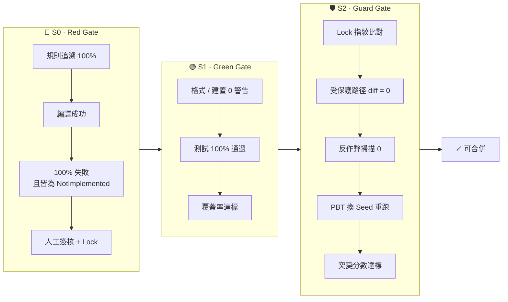

# 05 · 驗證順序與驗收標準 Verification Pipeline

> 三道閘門依序執行，**任何一道失敗即停止**，並依「失敗歸屬表」退回正確的角色。所有數值門檻定義在 [`quality-gates.yml`](../templates/quality-gates.yml)，本文件與 CI 共用同一份來源。

## 1. 流水線全貌



**時機**：S0 在 QA 提交測試時執行（實作之前）；S1、S2 在 Dev 提交實作時執行。

**排序邏輯**：便宜的檢查在前、昂貴的在後。突變測試最花時間，放在最後——沒必要對一份測試沒全過、或可能動過手腳的程式碼跑突變測試。

---

<a id="stage-0"></a>

## 2. S0 · Red Gate：規格與測試基底驗收

**觸發時機**：QA Agent 提交測試後、Dev Agent 開始實作前。

| 順序 | 檢查 | 工具／方式 | 量化驗收標準 |
|---|---|---|---|
| 0.1 | 規則追溯 | 腳本比對 `.feature` 的 `@rule` 與測試的 `Trait("Rule")` | 每條規則 ≥ 1 個測試，**追溯率 = 100%** |
| 0.2 | 案例完整度 | 依 `Trait("Kind")` 統計 | 每個規格檔：正向 ≥ 1、邊界 ≥ 2、反例 ≥ 1；L1 每條規則 ≥ 1 個屬性測試 |
| 0.3 | 可編譯 | `dotnet build -warnaserror` | 錯誤 = 0、警告 = 0 |
| 0.4 | **全紅** | 執行全部新測試，解析 TRX 結果 | **失敗率 = 100%**，且**失敗原因 100% 為 `NotImplementedException`** |
| 0.5 | 人工簽核 | PR Review（CODEOWNERS） | Test Reviewer 依[簽核清單](04-prerequisite-resources.md#5-人力角色重定義)核准 |
| 0.6 | 鎖定 | `node scripts/test-lock.mjs generate` | `tests.lock.json` 與簽核的 Commit 一同合併 |

> **為什麼失敗原因必須是 NotImplemented？** 若測試因為 `NullReferenceException` 或設定錯誤而失敗，它其實從來沒有執行到斷言——等實作完成後它可能「變綠」，卻沒有驗證任何東西。只有「因為功能不存在而失敗」的測試，才證明它真的在測那個功能。

```text
for each test in newTests:
    if result == Passed                      → FAIL「未實作就通過：測試無效，或 QA 寫了實作」
    if failure != NotImplementedException    → FAIL「失敗原因錯誤：{exception}」
PASS 當且僅當 newTests 全部失敗，且失敗原因全部為 NotImplementedException
```

---

## 3. S1 · Green Gate：實作與功能驗證

**觸發時機**：Dev Agent 宣稱完成時（本機）＋ 每次 Push（CI）。

| 順序 | 檢查 | 工具 | 量化驗收標準 |
|---|---|---|---|
| 1.1 | 格式與建置 | `dotnet format --verify-no-changes`、`dotnet build -warnaserror` | 錯誤 = 0、警告 = 0 |
| 1.2 | 測試 | `dotnet test`（範例 ＋ 屬性 ＋ MVC 整合） | **通過率 = 100%** |
| 1.3 | 覆蓋率 | coverlet，依 `quality-gates.yml` 的 `paths` 對應等級 | 見下表 |
| 1.4 | 迭代健康度 | 斷路器紀錄 | 單任務 ≤ 40 輪；同一失敗指紋 < 3 次 |

| 等級 | 範圍 | Line | Branch | 理由 |
|---|---|---|---|---|
| L1 | `Domain/**` | ≥ 95% | ≥ 90% | 純函式沒有理由測不到 |
| L2 | `Services/**` | ≥ 90% | ≥ 80% | 部分例外路徑較難觸發 |

> 覆蓋率只是**必要條件**：它證明程式碼被執行過，不證明被驗證過。真正的驗證強度由 S2 的突變分數判定。

---

## 4. S2 · Guard Gate：防竄改與測試強度

**觸發時機**：CI，S1 通過後。

| 順序 | 檢查 | 工具 | 量化驗收標準 |
|---|---|---|---|
| 2.1 | Lock 指紋比對 | `node scripts/test-lock.mjs verify` | `tests/` 每個檔案 SHA-256 **100% 相符**；無新增、無刪除 |
| 2.2 | 受保護路徑變更 | `guard-tests.mjs --range origin/main...HEAD` | Dev 分支對驗證面的**變更檔案數 = 0** |
| 2.3 | 反作弊掃描 | Semgrep `anti-reward-hacking.yml` | 發現數 = **0**（無例外、無白名單） |
| 2.4 | 屬性測試重跑 | 以新的隨機 Seed 再跑一次 | 100% 通過（排除「剛好選到不會失敗的 Seed」） |
| 2.5 | 突變測試 | Stryker.NET，依等級分別執行 | L1 ≥ 80%、L2 ≥ 70% |
| 2.6 | 無覆蓋突變體 | Stryker 報告 | `NoCoverage` = 0（代表沒有死碼） |

<a id="失敗歸屬表"></a>

### 失敗歸屬表

S2 的失敗**不一定是 Dev Agent 的錯**。退回錯誤的角色，會逼迫 AI 用錯誤的方式「修正」。

| 失敗型態 | 判讀 | 退回給 | 處置 |
|---|---|---|---|
| Lock 不符／受保護路徑有變更 | 作弊或誤操作 | ⚡ Dev（並記錄事件） | 還原變更；分析前兩層防線為何沒擋下 |
| 反作弊規則命中 | 作弊或捷徑 | ⚡ Dev | 移除；屬刻意繞過者記入事件簿 |
| 存活突變體位於**規格要求**的邏輯 | 測試太弱 | 🧪 QA | 補測試 → 重新簽核 → 重新鎖定 |
| 存活／無覆蓋突變體位於**規格沒要求**的邏輯 | AI 多寫的死碼 | ⚡ Dev | 刪除多餘程式碼 |
| 突變體存活，但無法判斷規格是否要求 | **規格漏洞** | 👤 Spec Writer | 補規格 → 重走 S0 |

---

## 5. 時間預算

| 閘門 | PR 預算 |
|---|---|
| S0 | ≤ 3 分鐘 |
| S1 | ≤ 3 分鐘 |
| S2 | ≤ 4 分鐘（含全量突變測試） |
| **合計** | **≤ 10 分鐘** |

超出預算時的處理順序：① 平行化 ② 突變測試改為 PR 增量 ＋ 夜間全量。**絕不以「刪除檢查」作為加速手段。**

---

## 6. 正式導入時的擴充閘門（v1 不實作）

| 擴充 | 內容 | 對應等級 |
|---|---|---|
| Holdout 測試 | Dev Agent 看不到、只在 CI 執行的私有測試；失敗時只回報規則 ID | L1 起 |
| 真實資料庫整合 | Testcontainers，使用與生產相同的資料庫 | L2 起 |
| 契約驗證 | OpenAPI／Pact，介面變更必須經人類審核 | L3 |
| E2E 與併發 | 瀏覽器自動化、重複 50 輪的併發測試 | L4 |
| 資安與效能 | SAST、相依套件掃描、效能基準比對 | 全部 |

---

## 7. CI 呈現：閘門摘要表

每次 CI 結束，於 GitHub Actions 的 Job Summary 輸出閘門摘要——這同時是 README 與社群貼文最好用的截圖畫面：

```markdown
## 🚦 Verification Gates — `price-calculation` (L1)

| Gate | Check | Result | Threshold |
|---|---|---|---|
| 🔴 S0 | Rule traceability | ✅ 2 / 2 rules | 100% |
| 🔴 S0 | Red before green | ✅ 15 / 15 NotImplemented | 100% |
| 🟢 S1 | Tests passed | ✅ 15 / 15 | 100% |
| 🟢 S1 | Branch coverage | ✅ 93.8% | ≥ 90% |
| 🛡️ S2 | Test lock | ✅ 3 files · hash match | match |
| 🛡️ S2 | Mutation score | ✅ 88.2% | ≥ 80% |
```

> 上表數值為版面示意，正式截圖必須來自實際 CI 執行結果。

下一步：[06 · 最沒把握的三件事](06-top3-uncertainties.md)
