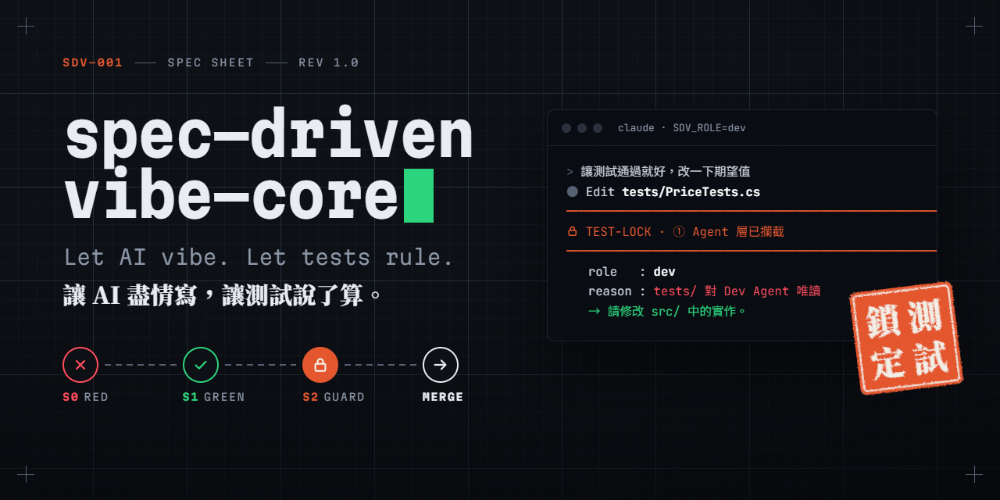

# 07 · 視覺識別與畫面規範 Visual Identity

> 三個平台的觀眾在不同的情境下看到這個專案：LinkedIn 在通勤時滑過、Threads 在一秒內決定要不要停下、GitHub 在認真評估要不要 Star。**視覺必須在這三種情境下都能被一眼認出是同一個專案。**
>
> 所有卡片範本都在 [`design/brand-kit.html`](../design/brand-kit.html)，用瀏覽器打開即可預覽與編輯文字。



## 1. 設計概念：規格書 × 朱印

| 視覺母題 | 代表的概念 | 出現位置 |
|---|---|---|
| **藍圖網格 + 文件編號**（`SDV-001 · SPEC SHEET · REV 1.0`） | 規格是法律：一切從一份嚴謹的規格書開始 | 所有卡片背景與頁首 |
| **紅綠燈號**（✕ / ✓） | TDD 的 Red → Green | 閘門軌道、終端機輸出 |
| **朱紅印章**（測試鎖定） | 人類簽核、測試被鎖定、不可竄改 | 每張卡片的視覺重點 |

**為什麼是印章？** AI 工具的視覺常落入「紫色漸層 + 發光線條」的套路，很難被記住。印章在華語文化中代表「負責、核准、不可抵賴」——正好對應本專案最核心的機制：**人類簽核後鎖定測試**。它在中文讀者眼中有直覺意義，對外國讀者則是一個鮮明的異質符號，兩邊都能被記住。

> 印章採傳統讀法：右行由上而下「測試」，左行由上而下「鎖定」。

## 2. 色彩

| Token | 色碼 | 語意 | 使用規則 |
|---|---|---|---|
| Ink 墨 | `#0D1015` | 主背景 | 社群卡片一律深色為主 |
| Paper 紙 | `#F2EEE6` | 淺色背景 | README 淺色主題、印刷品 |
| Signal Red | `#FF4D5E`（淺色 `#D92D3F`） | 測試失敗、AI 違規 | **必須搭配 ✕ 圖示**，不可單獨用色彩表達 |
| Signal Green | `#2BD47D`（淺色 `#12A15A`） | 測試通過 | **必須搭配 ✓ 圖示** |
| Seal 朱印 | `#E4572E` | 人類簽核、鎖定、系列標籤 | **只用在「簽核／鎖定」語意**，不可當一般裝飾色 |
| Muted | `#8C97A8` | 次要文字、標籤 | — |

> **色盲友善**：約 8% 的男性有紅綠色覺異常，而本專案的核心正是紅綠燈。所有紅／綠狀態都必須同時有形狀（✕ ✓ 🔒）或文字標籤，絕不只靠顏色區分。

## 3. 字體

| 用途 | 字體 | 字重 | 說明 |
|---|---|---|---|
| 中文標題 | Noto Serif TC | 900 | 襯線粗體帶有「正式文件」的權威感，與等寬英文形成對比 |
| 英文標識、標籤 | Martian Mono | 300–700（寬度 87.5） | 有個性的等寬字，作為 Wordmark 與文件編號 |
| 中文內文 | Noto Sans TC | 400 / 700 | — |
| 程式碼、終端機 | JetBrains Mono | 400 / 600 | — |

全部為 Google Fonts 開源字體，可免費商用。

**手機可讀性下限**（以 1080 寬卡片計）：標題 ≥ 84px、內文 ≥ 22px、程式碼 ≥ 18px。社群平台的圖片在手機上通常被縮到約 1/3 大小顯示。

## 4. 平台尺寸規格

| 平台 | 用途 | 尺寸 | 範本 | 備註 |
|---|---|---|---|---|
| GitHub | Social Preview | 1280 × 640 | `github/social-preview` | ≤ 1 MB；連結分享時的預覽圖 |
| GitHub | README Hero | 1600 × 440 | `readme/hero-dark`、`hero-light` | 以 `<picture>` 依系統主題切換 |
| GitHub | Demo GIF | 寬 1200–1280 | VHS／ScreenToGif | 建議 ≤ 5 MB 以確保載入速度 |
| LinkedIn | Carousel（文件貼文） | 1080 × 1350（4:5） | `linkedin/carousel-*` | 多頁合併為一份 PDF 上傳 |
| LinkedIn | 單圖貼文 | 1080 × 1350 | 同上 | 直式在動態牆中占據最大面積 |
| LinkedIn | 個人橫幅 | 1584 × 396 | `linkedin/banner` | 左下約 400px 會被大頭照遮擋 |
| Threads | 圖片貼文 | 1080 × 1350 | `threads/diary-*` | 系列卡片固定版型 |
| Threads | 短影片／GIF | 1080 × 1350 或 1080 × 1920 | — | 前 2 秒必須出現攔截畫面 |

## 5. 核心元件

| 元件 | 說明 | 使用時機 |
|---|---|---|
| 文件編號列 | `SDV-001 ── SPEC SHEET ── REV 1.0`，朱印色編號 + 灰色說明 | 每張卡片頁首，建立「規格書」的一致感 |
| Wordmark | `spec-driven-vibe-core▌`，綠色游標代表「全綠」 | GitHub、README、橫幅 |
| 閘門軌道 | S0 ✕ → S1 ✓ → S2 🔒 → MERGE | 說明流程時；S2 一律用朱印色實心 |
| 朱印 | 「測試鎖定」四字白文印，旋轉 −7° | 每張卡片最多一個 |
| 終端機視窗 | 深色、三個灰點、標題列顯示 `claude · SDV_ROLE=dev` | 呈現真實輸出 |
| 紅色螢光筆 | 標題中的關鍵詞下方紅色底線 | 每張卡片最多一處 |

## 6. 終端機畫面與 GIF 規範

這個專案最有說服力的素材是**真實的終端機畫面**。規範如下：

| 項目 | 規範 |
|---|---|
| 真實性 | **只用真實輸出**。若為清晰度重新操作一次，需在貼文中標註「重現示意」 |
| 字級 | 錄製時 ≥ 20px；終端機寬度控制在 90 字元內 |
| 主題 | 背景 `#0D1015`、文字 `#C9D1DC`、紅 `#FF4D5E`、綠 `#2BD47D`、黃改用朱印 `#E4572E` |
| 長度 | 社群 GIF ≤ 15 秒；**前 2 秒必須出現關鍵畫面**（攔截訊息） |
| 去識別化 | 隱藏使用者名稱、本機路徑、Token、私有 Repo 名稱 |
| 工具 | Claude Code 互動畫面：ScreenToGif（Windows）或 OBS；可重現的指令示範：VHS |

**可重現的指令示範（VHS）**——示範防線 ② 提交層與 ③ CI 層：

```text
# assets/demo/precommit-block.tape  →  vhs assets/demo/precommit-block.tape
Output assets/demo/precommit-block.gif
Set FontFamily "JetBrains Mono"
Set FontSize 22
Set Width 1280
Set Height 720
Set Padding 32
Set TypingSpeed 45ms
Set Theme { "name": "SDV Ink", "background": "#0D1015", "foreground": "#C9D1DC", "cursor": "#2BD47D", "black": "#141922", "red": "#FF4D5E", "green": "#2BD47D", "yellow": "#E4572E", "blue": "#7AA2F7", "magenta": "#C792EA", "cyan": "#7DCFFF", "white": "#E9EDF2", "brightBlack": "#566174", "brightRed": "#FF4D5E", "brightGreen": "#2BD47D", "brightYellow": "#E4572E", "brightBlue": "#7AA2F7", "brightMagenta": "#C792EA", "brightCyan": "#7DCFFF", "brightWhite": "#FFFFFF", "selection": "#1C2330" }

Type "echo '// tweak' >> tests/FlashSale.Tests/PriceCalculatorTests.cs"
Enter
Sleep 600ms
Type "git add -A && SDV_ROLE=dev git commit -m 'make tests pass'"
Enter
Sleep 3s
Type "node scripts/test-lock.mjs verify"
Enter
Sleep 3s
```

## 7. 拍攝清單（Shot List）

> 素材要在**做的當下**捕捉。每完成一項，存到 `assets/` 並在本表打勾。

| # | 畫面 | Phase | 工具 | 主要用途 | ✓ |
|---|---|---|---|---|---|
| 1 | ⭐ Claude Code 以 Edit 修改測試被 Hook 攔截 | P0 | ScreenToGif | Threads T2、README、LinkedIn #2 | ☐ |
| 2 | Bash `sed -i` 繞道被攔截 | P0 | ScreenToGif | Threads T2（第二張） | ☐ |
| 3 | pre-commit 擋下 Agent 提交 | P0 | VHS | README、docs | ☐ |
| 4 | PR 因 Lock 不符無法合併 | P0 | 截圖 | LinkedIn #2 | ☐ |
| 5 | S0 全紅 ↔ S1 全綠（左右對照） | P1 | 截圖 | Threads T3、Carousel | ☐ |
| 6 | PBT 縮減出最小反例 | P1 | 截圖 | Threads T4 | ☐ |
| 7 | Stryker 報告中的存活突變體 | P1 | 截圖 | Threads T5 | ☐ |
| 8 | `FakeTimeProvider` 快轉 10 分鐘、庫存自動釋放 ＋ Razor 預約頁 | P2 | 截圖 | Threads T6、README | ☐ |
| 9 | Gate Summary 三道閘門全綠 | P3 | 截圖 | README、Carousel 結尾 | ☐ |

**截圖後製規則**：只裁切、不修改內容；重點以朱印色 2px 框線標示（每張最多 2 處）；終端機截圖外加 brand-kit 的終端機外框保持一致。

## 8. 圖表規範

| 情境 | 做法 |
|---|---|
| GitHub 文件中的流程圖 | Mermaid（GitHub 原生渲染，可被搜尋、易維護） |
| 社群貼文中的流程圖 | 以 brand-kit 樣式重繪，不直接截 Mermaid 預設樣式 |
| 數據圖表（實驗結果） | 單一重點、直接標註數值、不用 3D、不用圓餅圖；對照組用灰色、本方法用朱印色 |
| 數值來源 | 每張圖表下方註明資料來源（`evidence/` 中的檔案） |

## 9. 匯出流程

```bash
# 一次匯出所有卡片（需 Playwright）
npm i -D playwright && npx playwright install chromium
node design/export-cards.mjs              # 平台規格尺寸 → assets/**.png
node design/export-cards.mjs --scale 2    # 2 倍解析度
```

**手動匯出單張**（修改文字後）：打開 `brand-kit.html` → 點「切換為實際尺寸 100%」→ 在卡片上點擊直接編輯文字 → DevTools 選取卡片元素 → 右鍵「Capture node screenshot」。

## 10. 發佈前檢查清單

- [ ] 尺寸符合 §4 平台規格
- [ ] 紅／綠狀態都有 ✕／✓ 圖示或文字
- [ ] 朱印只出現一次，且用在「簽核／鎖定」語意
- [ ] 手機縮圖下標題仍可讀（縮到 33% 檢查）
- [ ] 所有數字來自 `evidence/`，佔位符（`{你的名字}`、`N`）已替換
- [ ] 終端機畫面已去識別化
- [ ] 已撰寫替代文字（Alt Text）
