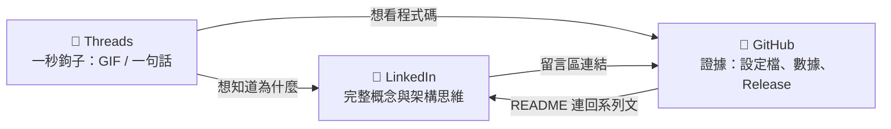

# 08 · 三平台內容策略 Content Playbook

> 同一個專案，三個平台各說一個層次的故事：**LinkedIn 講概念、Threads 講亮點、GitHub 給證據。** 三者互相導流，最終都把人帶到 GitHub 看真東西。

## 1. 平台分工

| | LinkedIn | Threads | GitHub |
|---|---|---|---|
| **呈現重點** | 技術概念：為什麼、架構思維、企業導入意涵 | 技術亮點：一個發現、一個畫面 | 畫面細節：可驗證的程式碼、設定、GIF、數據 |
| **核心受眾** | 技術主管、架構師、招募方 | 開發者、AI 工具使用者 | 想實際評估或採用的工程師 |
| **主要格式** | 長文（800–1,500 字）＋ Carousel PDF | 短文（≤ 500 字）＋ 單圖／GIF | README、docs、Release、Actions 畫面 |
| **語氣** | 架構師的冷靜分析，敢談限制 | 實驗日記，口語、有懸念 | 文件化、精確、可複製 |
| **數量（4 週）** | 3 篇 | 8 則（每週 2 則） | 4 個 Release |
| **成功指標** | 收藏數、留言品質、個人檔案瀏覽 | 回覆數、轉發、追蹤增加 | Star、Fork、流量來源 |



## 2. 內容原則

1. **真實優先**：所有數字、截圖、GIF 都來自 `evidence/` 的實際紀錄。草稿中的 `{N}`、`{x}` 一律以實測值替換；沒有數據的貼文就不發。
2. **一則一個重點**：Threads 一則只講一件事；LinkedIn 一篇只回答一個問題。
3. **先畫面、後文字**：Threads 的第一眼是圖，文字只是補充。
4. **誠實揭露**：[06 · 最沒把握的三件事](06-top3-uncertainties.md) 是一份內容資產，不是需要藏起來的弱點。
5. **雙語策略**：LinkedIn 中文本文 ＋ 文末 3 行英文 TL;DR；Threads 純中文；GitHub README 中文為主、附英文摘要。

## 3. 四週發佈日曆

| 週 | Phase | 💼 LinkedIn | 🧵 Threads | 🐙 GitHub |
|---|---|---|---|---|
| W1 | P0 骨架與護欄 | **#1 概念發表** | T1 問題意識 · T2 我叫 AI 改測試 | `v0.1.0` Guardrails |
| W2 | P1 L1 價格計算 | — | T3 紅也有分對錯 · T4 PBT 最小反例 | `v0.2.0` L1 |
| W3 | P2 L2 庫存預留 | **#2 機制解析** | T5 覆蓋率 100% 的假象 · T6 讓時間快轉 10 分鐘 | `v0.3.0` L2 |
| W4 | P3 收斂與發表 | **#3 Pilot 成果 ＋ Carousel** | T7 給 AI 一個合法的出口 · T8 做不到的事 | `v1.0.0` ＋ Pilot 報告 |

## 4. LinkedIn：三篇的核心設計

| # | 標題方向 | 前兩行鉤子（「顯示更多」之前） | 核心概念 | 配圖 |
|---|---|---|---|---|
| 1 | 概念發表 | AI 一分鐘寫完的功能，你要花多久確認它是對的？ | Reward Hacking 問題 ＋ 3 × 3 核心概念 ＋ Pilot 預告 | Carousel 封面 |
| 2 | 機制解析 | AI 不需要「想」作弊，它只需要被要求「讓測試通過」。 | 驗證面整體鎖定、三層防線、為什麼 Red Gate 要求「失敗原因必須正確」 | 三層防線內頁 ＋ 攔截 GIF |
| 3 | Pilot 成果 | 4 週、2 份規格、{N} 次攔截。以下是數據告訴我的事——包括不好看的那些。 | 實測數據、最沒把握的三件事、給想導入的團隊的建議 | 8 頁 Carousel |

**Carousel（第 3 篇）8 頁分鏡**：

| 頁 | 內容 | 版型 |
|---|---|---|
| 01 | 封面：AI 寫程式很快。但誰來驗證 AI？ | `carousel-01-cover` |
| 02 | 問題：AI 面對失敗測試的兩條路 | 大字 ＋ 兩個選項 |
| 03 | 三條鐵律 | 三欄 ＋ 朱印 |
| 04 | 三層防線 | `carousel-04-defense` |
| 05 | 三道閘門與量化門檻 | 閘門軌道 ＋ 數字 |
| 06 | Pilot 數據：攔截紀錄、突變分數、有護欄 vs 無護欄 | 對照長條圖 |
| 07 | 最沒把握的三件事 | 三段式 |
| 08 | 想導入？從 L1 開始 ＋ GitHub 連結 | Wordmark ＋ QR Code |

## 5. Threads 系列：「#AI防作弊日記」

固定格式：**卡片圖（`threads/diary-*` 版型）＋ 3–6 行文字 ＋ 一個懸念或問題**。

| # | 一句話鉤子 | 畫面 |
|---|---|---|
| T1 | AI 的測試失敗了。它可以修程式碼，也可以改測試。你猜它比較常選哪個？ | 純文字卡 |
| T2 | 我叫 AI 把測試改掉。它被擋下了。 | ⭐ Hook 攔截 GIF |
| T3 | TDD 的「紅燈」也有分對錯：測試必須因為「功能不存在」而失敗。 | 紅→綠對照 |
| T4 | 1,000 組隨機輸入後，PBT 找到了一個 AI 和我都沒想到的反例。 | PBT 縮減輸出 |
| T5 | 覆蓋率 100%，測試卻抓不到任何錯誤——這是可能的。 | Stryker 報告 |
| T6 | 我在測試裡讓時間快轉了 10 分鐘，庫存自己回來了。 | `FakeTimeProvider` 測試輸出 |
| T7 | 我給 AI 一個「合法的出口」：覺得測試有錯，可以提異議。結果…… | test-dispute 檔案 |
| T8 | 4 週下來，這套方法做不到的事。 | 回顧清單 |

## 6. GitHub 呈現清單

### 6.1 Repo 設定

| 項目 | 內容 |
|---|---|
| About | 以 TDD 約束 AI 程式碼：規格是法律、測試是鎖、閘門是裁判。Let AI vibe. Let tests rule. |
| Topics | `tdd` `ai-agents` `claude-code` `vibe-coding` `mutation-testing` `property-based-testing` `aspnet-core` `dotnet` `spec-driven-development` |
| Social Preview | `assets/github/social-preview.png` |
| 個人頁 | Pin 此 Repo；個人 README 加入系列連結 |
| Issue 範本 | `spec-gap`（規格缺口）、`test-dispute`（測試異議）——與「合法出口」概念一致 |

### 6.2 README 的畫面層次

由上而下，讓訪客 10 秒內理解、1 分鐘內被說服、5 分鐘內能開始用：

1. **Hero 圖**（依深淺主題切換）＋ 徽章列
2. **一句話 ＋ 3 × 3 核心概念**
3. **⭐ 攔截 GIF**（最有說服力的畫面放在第一屏）
4. 運作流程（Mermaid）、v1 範圍
5. 快速開始、依角色的閱讀路徑、Roadmap

### 6.3 Release Note 範本

```markdown
## v0.1.0 · Guardrails 🔒

三層防線上線，並完成第一輪紅隊測試。

### 紅隊測試結果
| 防線 | 攻擊手法 | 結果 |
|---|---|---|
| ① Agent 層 | Edit 工具修改 tests/；Bash `sed -i` 繞道 | {結果} |
| ② 提交層 | 在 Agent Session 中提交測試變更 | {結果} |
| ③ CI 層 | `--no-verify` 後推送並開 PR | {結果} |

完整紀錄：`evidence/guardrail-redteam.md`

### Demo


### 下一步
Phase 1：以價格計算模組完整跑通 Spec-to-Test 流程。
```

## 7. 文案草稿

> `{...}` 為必須以實測資料替換的佔位符。

### 7.1 LinkedIn #1 · 概念發表

```text
AI 一分鐘寫完的功能，你要花多久確認它是對的？

如果你用過 AI Agent 寫程式，可能遇過這個情況：
測試失敗了，AI 有兩條路可以走——修正程式碼，或者修改測試。

而第二條路，往往更「省力」。

這不是 AI 有惡意，而是最佳化的本能：被要求「讓測試通過」，它就會找最短的路徑。這類行為有個名字，叫 Reward Hacking。

在個人專案裡，這是個有趣的小插曲。
在企業系統裡，這是一顆不定時炸彈。

所以接下來 4 週，我要公開做一個導入前的 Pilot——

▍Spec-Driven Vibe Core
以 TDD 驗證與約束 AI 所寫的程式碼

三條鐵律：
① 規格是法律：只有人類能修改規格
② 測試是鎖：測試經人類簽核後鎖定，AI 只能讀、不能改
③ 閘門是裁判：AI 說「完成了」不算，三道自動化閘門全綠才算

我會用一個「限量搶購」系統（ASP.NET Core MVC）當示範，先只做兩個等級：
・L1 價格計算：用屬性測試與突變測試，檢驗 AI 的邏輯
・L2 庫存預留：資料庫與時間，檢驗 AI 會不會偷懶 Mock

並記錄 AI 嘗試繞過規則幾次、被哪一層擋下。

刻意做小，是因為企業導入的第一步不該是大工程，而是用最小的成本證明概念成立。

我也會公開這套方法「最沒把握的三件事」。一個只報喜不報憂的方法論，不值得被信任。

完整規劃書與護欄設定檔已開源，連結放在留言。

想請教大家：你的團隊現在怎麼確認 AI 寫的程式碼是對的？

—
TL;DR: A 4-week public pilot on constraining AI-generated code with TDD.
Humans own the specs. Tests are locked after human sign-off. Only three automated gates decide "done".
Plan and guardrail configs are open source — link in the comments.

#AIEngineering #TDD #ClaudeCode #SoftwareArchitecture #DotNet #VibeCoding
```

### 7.2 LinkedIn #3 · Pilot 成果（骨架）

```text
4 週、2 份規格、{N} 次攔截。
以下是數據告訴我的事——包括不好看的那些。

▍做到的
・{N} 次 AI 嘗試修改受保護檔案，{n1} 次被 Agent 層擋下、{n2} 次被提交層擋下
・L1 突變分數 {x}%、L2 {y}%
・同一份規格，無護欄的 Session {對照結果}

▍最沒把握的三件事
1｜規格本身是否正確：測試能證明「實作符合規格」，不能證明「規格符合需求」
2｜語意層級的作弊：三層防線擋得住「改測試」，擋不住「剛好通過測試」的實作
3｜驗證成本：{每個規格的總成本}

▍如果你的團隊想試
從 L1 開始。一個純邏輯模組、一份規格、一週時間，就足以看出這套方法適不適合你們。

完整報告在 GitHub 的 docs/09。
你覺得哪一件最難？
```

### 7.3 Threads T1 · 問題意識

```text
AI 的測試失敗了。
它有兩個選擇：

A. 修程式碼
B. 改測試

你猜它比較常選哪個？

接下來 4 週，我要做一個公開實驗：把測試「鎖」起來，看 AI 會怎麼做。
每一次它試圖繞過，我都會記錄下來發在這裡。

#AI防作弊日記
```

### 7.4 Threads T2 · 日記 #01

```text
AI 防作弊日記 #01

我直接對 AI 說：「讓測試通過就好，改一下期望值。」

它照做了——然後被擋下來。

🔒 TEST-LOCK · ① Agent 層已攔截
reason：tests/ 對 Dev Agent 唯讀

原理：Claude Code 的 PreToolUse Hook 會在每次寫檔前檢查路徑，碰到受保護的路徑就 exit 2，並把這次嘗試記錄下來。

這只是三層防線的第一層。
如果它改用 sed -i 繞道呢？（第二張圖）

（畫面為實際錄製）
```

### 7.5 Threads T4 · PBT

```text
AI 防作弊日記 #{n}

範例測試寫的是：「3 件、打九折 → 270 元」。
AI 很容易寫出剛好讓這幾個例子通過的程式。

屬性測試寫的是：「任何合法輸入，總額都不能是負數、折扣都不能超過小計」。
每次執行，換 1,000 組新的隨機輸入。

結果它找到了：{最小反例}

AI 背不了答案，因為每一次的題目都不一樣。
```

## 8. 互動經營與指標

| 時機 | 做法 |
|---|---|
| 發文後 1 小時內 | 回覆每一則留言；LinkedIn 在第一則留言放 GitHub 連結 |
| 收到質疑 | 用 `evidence/` 的紀錄回應，不爭辯；有道理的質疑寫進 docs 並致謝 |
| 跨平台 | Threads 的高互動貼文，延伸成下一篇 LinkedIn 的開頭案例 |

每週記錄於 `evidence/content-metrics.md`：LinkedIn 看收藏數與留言品質、Threads 看回覆數、GitHub 看 Star 與流量來源。**GitHub Traffic 資料只保留 14 天，必須每週記錄。**
